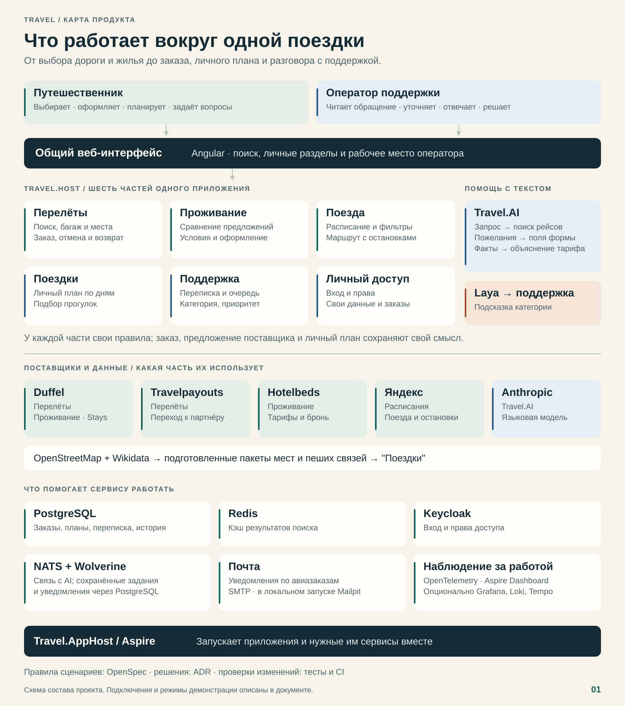
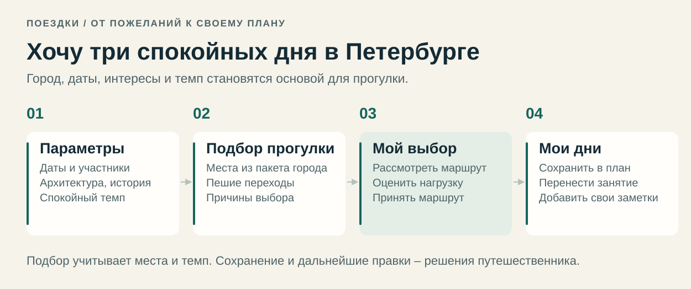
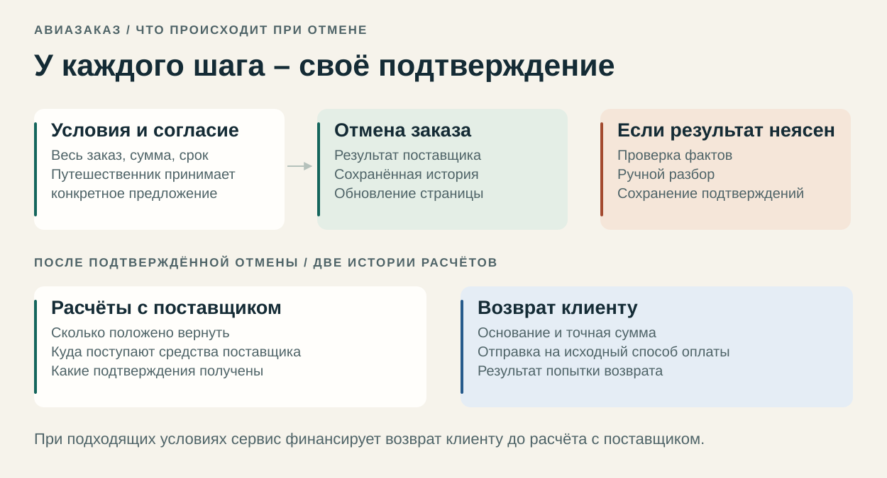
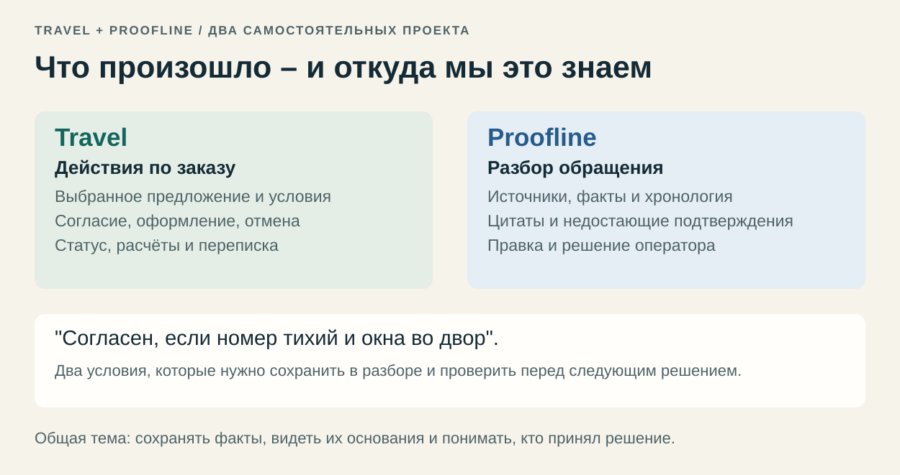

# Travel: из чего складывается поездка

Билеты, жильё, планы на день и помощь, когда обстоятельства меняются.

На выходных хочется в Петербург. Погулять, посмотреть на город, никуда особенно не спешить. Но между этой мыслью и собранным чемоданом появляются вопросы. Самолёт или поезд? Почему два похожих билета стоят по-разному? Включён ли завтрак? Успеем ли пройти всё, что наметили? И что делать с бронью, если планы изменятся?

**Travel – авторский проект сервиса путешествий, в котором можно пройти через эти решения и посмотреть, как они устроены.** Здесь есть поиск перелётов и жилья, расписания поездов, личный план поездки и поддержка. Самые интересные вещи обнаруживаются в деталях: в объяснении цены, в согласовании новых условий, в сохранённой истории заказа.

> **⚠️ Disclaimer: особенности демонстрации** Travel и соседний Proofline созданы для портфолио, статей и разбора продуктовых и инженерных решений. Это демонстрационные приложения с открытым кодом; их сценарии используют подготовленные данные, а оформление, оплата и возвраты показываются в тестовом режиме. Подключение настоящих поставщиков и моделей работает по принципу **BYOK – со своими аккаунтами и ключами**: владелец запуска отвечает за доступ, расходы, условия использования данных и передачу личной информации. Ключи хранятся на сервере. Экспериментальные функции включаются отдельно; реальные продажи, качество AI и маршрутов, промышленная эксплуатация и экономический эффект требуют собственных проверок. Железнодорожный раздел служит для выбора поездки по расписанию; пешие маршруты показывают расчётное время. Разделы Travel имеют самостоятельные сценарии, без общей корзины турпакета. Proofline – отдельное приложение, связанное с Travel тематикой работы с обращениями. Дальше речь о том, что можно увидеть в этих проектах и зачем это сделано.

## Вся картина

У путешественника своя сторона сервиса: выбрать, сравнить, сохранить, вернуться к заказу. У сотрудника поддержки – своя: прочитать обращение, уточнить детали и довести разговор до решения. Под ними находятся шесть частей Travel и сервисы, которые помогают им работать.

*Схему можно [открыть отдельно](assets/travel-map.svg) и рассмотреть крупнее. Названия технологий оставлены рядом с их назначением: по карте можно пройти и с продуктовой, и с инженерной стороны.*

## Сначала понять, как добраться

У перелёта много характеристик, и цена – только одна из них. Есть время в пути, пересадки, багаж, аэропорты, условия обмена и отмены. Travel собирает эти сведения в предложение, которое можно спокойно рассмотреть перед оформлением.

Порядок результатов объясним: сначала цена в соответствующей валюте, затем известная длительность и число пересадок. Рядом остаются сведения, на которых основан выбор. Дешёвый вариант с неудобным маршрутом легко заметить и сравнить с соседним.

Поездка может включать от одного до четырёх перелётов в одном заказе. Например, прилететь в один город, проехать часть пути самостоятельно и улететь из другого. На экране видны все участки, местное время аэропортов и промежуток, который путешественник организует сам. Для компании можно оформить до девяти взрослых; сохранённые профили помогают заполнить данные тех, с кем часто летаешь.

Перед заказом человек проверяет актуальное предложение, выбирает багаж и места для конкретных пассажиров, видит состав и общую сумму. Если условия изменились, появляется повод ещё раз принять решение. Старая цена из поисковой выдачи не превращается незаметно в согласие на новую покупку.

Для поездов и электричек есть отдельный раздел. В нём выбирают станции и дату, сравнивают отправление, прибытие и длительность, отбирают подходящее время и перевозчика. У выбранного рейса можно посмотреть маршрут с остановками. Это удобно, когда важен не только конечный город, но и конкретная станция по пути.

## Затем выбрать, где остановиться

С отелями сравнение быстро усложняется. Один и тот же объект встречается у разных поставщиков; похожие названия номеров скрывают разное питание и условия отмены. Сумма на карточке может включать часть платежей, а часть придётся внести на месте.

Travel умеет искать проживание у Duffel Stays и Hotelbeds. Предложения сопоставленного отеля собираются вместе, а внутри сохраняются различия между номерами, тарифами и источниками. В текущем сценарии можно выбрать один номер для одного или двух взрослых.

Сравнение ведётся за всё проживание. Сервис показывает, что входит в сумму, какие обязательные платежи известны и кому их нужно заплатить. Цена поставщика и цена для путешественника имеют свои подписи. Так проще понять, за счёт чего один вариант выглядит дешевле другого.

После выбора Travel ещё раз получает актуальные условия и сохраняет связь покупки с конкретным поставщиком. К результату можно вернуться в личном доступе: увидеть выбранное предложение, его источник и состояние оформления.

## Освободить голову для самой поездки

Когда с дорогой и жильём стало понятнее, хочется перестать держать всё в голове. В разделе "Поездки" можно собрать личный план: город, даты, участников, интересы, темп и бюджет. Внутри каждого дня – свои заметки и занятия. Их можно менять местами, переносить на другой день, дополнять временем и оценкой расходов.

План рассчитан на одну поездку длительностью до двух недель. Если сократить даты и тем самым убрать заполненный день, Travel предложит сначала разобраться с его содержимым. Если два занятия пересекаются по времени, это будет видно. Такие небольшие решения берегут уже проделанную работу.

Для Москвы и Петербурга есть подбор прогулок на один–три дня. У него понятные исходные данные: места, интересы, связи между точками и выбранный темп. Спокойный день получает меньше остановок и переходов; насыщенный – больше. В предложении видно, какие интересы удалось учесть и сколько примерно предстоит пройти.

Предложенный маршрут сначала открывается для просмотра. Человек выбирает, подходит ли ему такой день, и переносит понравившийся вариант в свой план. Дальше его можно редактировать как обычные записи. Бюджет, заметки и принятые решения остаются под рукой, даже если первоначальная идея поездки изменилась.

## После кнопки "Оформить" история продолжается

Покупка редко заканчивается одним ответом сервера. Бронь появляется у поставщика, затем приходят подтверждения, меняется статус, выпускаются документы. Путешественник открывает заказ позже – возможно, уже с другого экрана – и хочет увидеть, что произошло.

В Travel есть список своих заказов и отдельная страница каждого из них. Она показывает сохранённые сведения и обновляет состояние по мере поступления изменений. За заказом можно наблюдать, вернуться к нему после перезагрузки и продолжить с известного результата.

Самый показательный момент – потеря связи во время оформления. Нажать ещё раз кажется естественным. Но первый запрос мог уже создать бронь. Travel сохраняет сведения о попытке, проверяет её результат и, когда требуется, передаёт ситуацию на ручной разбор. В интерфейсе у такого случая есть собственное состояние и понятный следующий шаг.

Отмена тоже начинается с решения человека. Сервис получает текущие условия: что будет отменено, какая сумма возвращается по правилам поставщика, куда она поступит и до какого времени предложение действует. Путешественник видит весь заказ и подтверждает конкретные условия.

В истории отдельно отражаются отмена, расчёты с поставщиком и возврат клиенту. При подходящих условиях сервис может профинансировать возврат клиенту, пока расчёты с поставщиком ещё продолжаются. Это отвечает на очень практичный вопрос: "На каком шаге сейчас мои деньги?" Если подтверждения ещё нет, сотрудник видит, какое именно событие нужно выяснить. Состояние заказа становится основой для разговора с клиентом.

## Когда нужен человек

В Travel можно открыть обращение, описать вопрос и, при необходимости, связать его со своим авиазаказом. Переписка сохраняется в личном разделе. Можно прочитать ответ позже, уточнить детали или вернуться к закрытому вопросу.

У оператора отдельная очередь: новые обращения, разговоры, ожидающие ответа клиента, решённые вопросы. Он отвечает, выбирает категорию и приоритет, закрывает обращение. Каждое действие сохраняется вместе с автором и временем.

Для первичного разбора Laya предлагает категорию обращения. Приоритет подсказывают правила сервиса с учётом проверенных сведений об авиазаказе. Оператор сам запрашивает подсказку, смотрит результат и решает, что сохранить. Такой порядок оставляет человеку возможность учитывать то, что не укладывается в короткую формулировку обращения: тон переписки, историю вопроса, недостающие обстоятельства.

## Где помогает AI

В поездке естественно начинать с обычной фразы. Travel.AI умеет превращать текстовый запрос в поиск перелётов. Для планировщика подготовлен разбор пожеланий по полям: город, даты, число взрослых, интересы, темп.

В планировщике перед переносом в форму извлечённые значения можно проверить и исправить. Рядом остаётся исходный текст. Если человек написал неоднозначно, интерфейс помогает уточнить нужное поле. Сохранение плана происходит следующим, отдельным действием.

Ещё одно применение – объяснение условий тарифа. Основу составляют сведения о конкретном предложении: багаж, правила отмены и обмена, известные суммы. AI может помочь расположить эти сведения в читаемом порядке. Для этого ему передаётся ограниченный набор фактов с проверяемыми ссылками внутри системы.

У AI в Travel несколько небольших, ясных задач. Поиск понимает запрос. Разбор пожеланий готовит форму. Объяснение помогает прочитать условия. Подсказка поддержки помогает начать разбор. Подбор самих прогулок выполняется по данным и правилам: интересам, темпу и связям между местами.

## Что за этим стоит для бизнеса

Человек приходит в туристический сервис за поездкой. Компания при этом должна согласовать условия с поставщиками, сохранить договорённости и разобраться с последствиями каждого действия. В Travel эти обязанности видны на конкретных примерах.

**Объяснимый выбор.** Когда на экране видны состав цены, багаж и условия отмены, путешественнику проще сопоставить варианты. Разницу между предложениями можно объяснить на конкретных фактах.

**Работа с несколькими поставщиками.** У каждого свои названия, форматы и правила. Внутри Travel они приводятся к общему представлению, а происхождение предложения сохраняется до покупки. Это даёт продукту общий интерфейс и оставляет операционной команде нужные подробности.

**Контроль дорогих ошибок.** Повторная бронь, повторный платёж или возврат без подтверждения стоят компании денег и доверия. Поэтому у чувствительных действий есть история, точные условия и порядок разбора неопределённого результата.

**Контекст для поддержки.** Обращение, связанный заказ, переписка и авторство действий позволяют продолжить работу с места, на котором она остановилась. Клиенту легче объяснить происходящее, когда у сервиса есть последовательная история.

**Возможность развивать продукт по частям.** Перелёты, отели, поезда, планы и поддержка имеют свои правила. Это помогает обсуждать и менять конкретный сценарий: например, улучшить выбор гостиничного тарифа или работу с отменой, сохранив понятные границы соседних частей.

## Proofline: когда ответ лежит в переписке

В заказе можно хранить дату, сумму и статус. Но часть важных обстоятельств живёт в письмах и сообщениях. Клиент согласился на замену? Что именно ему предложили? Какие условия он поставил? Достаточно ли подтверждений, чтобы двигаться дальше?

[Proofline](https://github.com/svasorcery/proofline/blob/master/docs/product/proofline.ru.md) посвящён этой работе. Он готовит для оператора разбор обращения: факты, хронологию, цитаты и список того, что ещё нужно выяснить. Нажатие на цитату открывает соответствующий фрагмент источника. Можно увидеть, откуда взялось утверждение, и проверить его в контексте.

Представим переписку о замене номера. Клиент пишет: "Согласен, если номер тихий и окна во двор". В такой фразе есть два условия. Если разбор объявит замену принятой, оператор должен заметить расхождение. В Proofline он может исправить факт, сохранить новую версию с объяснением и зафиксировать решение. Исходный разбор и использованные документы остаются в истории.

Эти проекты интересно рассматривать вместе. Travel показывает, как сервис выполняет и учитывает действия. Proofline – как человек проверяет основания для следующего решения. В обоих случаях важны конкретные вопросы: что произошло, на чём основан вывод и кто принял решение.

## Что можно обсудить, открыв проект

Travel даёт несколько удобных точек входа для знакомства. Начать можно с понятной карточки перелёта, затем пройти к оформлению и посмотреть случай с потерянным ответом. Или сравнить гостиничные тарифы, собрать прогулку по Петербургу, открыть обращение от лица клиента и ответить на него как оператор.

За любым из этих действий находится более глубокая тема: как сравнивать цены, хранить согласие, защищать личные сведения, обновлять экран без повторной покупки, проверять AI-подсказку. Поэтому проект можно читать на разной глубине. Сначала – как историю путешественника. Затем – как набор решений команды, которая строит для него сервис.

К проекту можно возвращаться с новым вопросом. Почему предложение оказалось первым в выдаче? Что делать, если поставщик создал бронь, а ответ потерялся? Как показать оператору, что фраза "согласен, если…" ещё требует продолжения разговора? Здесь есть и сами ситуации, и решения, которые можно открыть, попробовать и обсудить.

---

**Посмотреть дальше:** [код и запуск Travel](../../README.md) · [архитектура](../architecture/current-state.md) · [контракты сценариев](../../openspec/specs/) · [решения и их причины](../adr/) · [Proofline](https://github.com/svasorcery/proofline/blob/master/docs/product/proofline.ru.md) · [статьи автора](https://blog.vsinyavsky.ru/).
